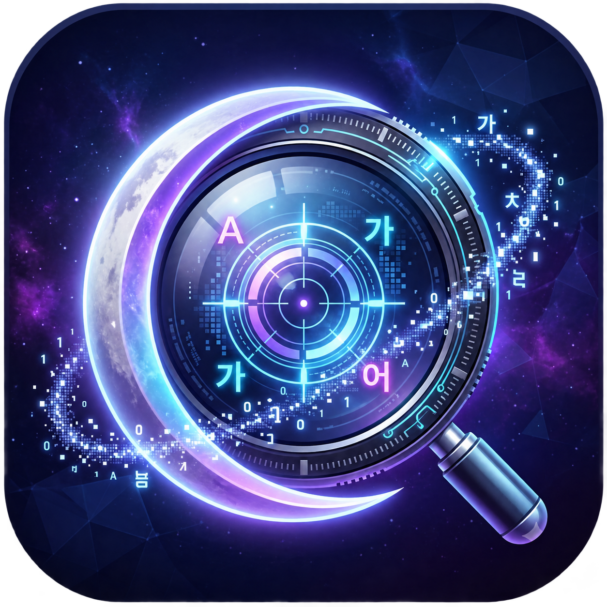

<p align="center">
  
</p>

<h1 align="center">DalvitLens (달빛렌즈)</h1>

<p align="center">
  <b>플레이의 흐름을, 한글로 (v1.3.0)</b><br/>
  전처리 대비 강화 OCR · 영/일/중 다국어 스위치 · 가시적 F8 범위/방향 에디터 · 캡처 영역 실시간 프리뷰 · 고정 영역/커서 기준 원클릭 전환 · 내 PC GPU 로컬 AI 번역 · OBS 방송 송출
</p>

---

## 3분 사용 가이드 영상

> **☕ 개발자에게 무료로 힘 실어주는 법**  
> 이 프로그램은 안 한글 스팀 게임 하다가 답답해서 직접 깎은 무료 도구입니다.  
> 다운로드해서 잘 쓰셨다면 **값비싼 후원 대신 아래 유튜브 가이드 영상에 [구독]과 [좋아요] 한 번씩만 툭 던져주시면 감사하겠습니다!** (구독자 늘어나면 신나서 기능 더 깎아옵니다)

<p align="center">
  <a href="https://youtu.be/3O_VA_0FIGs">
    
  </a>
</p>

- **가이드 영상 바로가기**: [https://youtu.be/3O_VA_0FIGs](https://youtu.be/3O_VA_0FIGs)
- 핵심 단축키(`F8` 주변 / `F9` 전체 / `F7` 다음 묶음 / `F10` 숨김), 번역 엔진 선택, 1초 단어 교정·자동 용어집, OBS 방송 투명 송출 세팅까지 3분 만에 확인할 수 있습니다.

---

## 주요 특징

- **원문 회피 & 클릭 통과 오버레이**: 인식된 원문 영역을 피해 가장 가까운 빈 공간에 번역 카드를 자동 배치하고 번호표(`1, 2, 3`)로 대조합니다. 번역이 떠 있어도 마우스 클릭이 게임으로 그대로 통과하며 창 포커스를 빼앗지 않습니다.
- **전처리 대비 강화 OCR 엔진 (`DalvitOcrEnhancer` · v1.1.0 신규)**: 어두운 반투명 카드나 작은 컬러 게임 폰트(`11~14px` 보라·금색·적색 텍스트)에서도 글자 획을 뚜렷하게 검출하도록 **적응형 `2.0x`/`1.5x` 바이큐빅 업스케일링 + 컬러 채도(Chroma) 가중 휘도 부스트 + 히스토그램 백분위 S-커브 대비 스트레칭 + `3×3` 언샤프 마스크(Unsharp Mask) 샤프닝** C# 네이티브 전처리 엔진과 2-Pass 원본 폴백 파이프라인을 적용했습니다.
- **영 / 일 / 중(`EN / JA / ZH`) 다국어 원문 스위치 (v1.1.0 신규)**:
  - 설정 창 상단의 **`[영어 (EN)]` · `[일본어 (JA)]` · `[중국어 (ZH)]`** 스위치 버튼 또는 **작업 표시줄 트레이 우클릭 메뉴**에서 원문 언어를 1초 만에 전환할 수 있습니다.
  - 일본어·중국어 줄바꿈 시 불필요한 띄어쓰기 없이 문장을 자연스럽게 이어 붙이고, 글자 사이 OCR 오인식 공백 제거 및 전각 기호(`％`, `＋`, `－`) 정규화, **`[일/중 OCR 언어팩 설치]`** 원클릭 도우미를 지원합니다.
- **게임 발번역 & OCR 노이즈 해결**: 스탯 아이콘 오인식 노이즈(`(A)`, 깨진 기호 등)를 자동 정제하고, RPG 전용 문맥 프롬프트와 조건문 수치(`below`=미만 / `above`=초과) 규칙으로 직역·오역을 잡아냅니다.
- **5종 번역 엔진 & 단일 GPU 메모리 관리**:
  - `EXAONE 3.5 7.8B` *(기본 추천 · 한국어 특화 고품질 로컬 GPU)*
  - `TranslateGemma 4B` *(중간 체급 로컬 GPU)*
  - `Hy-MT2 1.8B` *(초경량·초고속 로컬 GPU, 전용 VRAM ~1.5GB)*
  - `Google 간편 연결` *(API 키 불필요 · GPU 부하 0%)*
  - `Google Cloud` *(공식 Translation Basic API)*
  - 엔진 전환 시 이전 GPU 프로세스를 즉시 종료해 그래픽카드 메모리에 항상 단일 모델만 유지하며, 번역 캐시도 모델별로 독립 분리됩니다.
- **자동 학습 용어집 (`glossary.json`)**:
  - **무조작 백그라운드 수집**: 번역 오버레이를 먼저 화면에 띄운 뒤(체감 지연 0ms), 유휴 시간에 신규 대문자 UI 라벨·고유 스킬명을 자동 추출해 저장합니다.
  - **1초 단어 교정**: 설정 창 하단 교정 칸에서 어색한 단어만 고치고 `[교정 적용 · 용어집 학습]`을 누르면 한국어 조사(`을/를/이/가` 등)를 자동 분리해 핵심 명사 규칙을 영구 학습하고 현재 화면과 OBS에 즉시 반영합니다.
- **OBS Studio 1080p 투명 송출**: `http://127.0.0.1:18765/` 브라우저 소스 하나로 4K(`3840×2160`) 게임 좌표도 `1920×1080` 방송 캔버스에 자동 스케일링하며, 내 모니터와 OBS 송출 화면의 배경 불투명도를 개별 제어합니다.

---

## 빠른 시작 (설치 및 실행)

### 요구 환경
- **OS**: Windows 10 / 11 (64-bit)
- **Windows OCR 언어팩**: 영어(`en-US`), 일본어(`ja-JP`), 중국어(`zh-CN` / `zh-TW`) 중 번역할 게임의 원문 언어팩 *(설정 창의 `[일/중 OCR 언어팩 설치]` 버튼으로 1클릭 자동 설치 가능)*
- **GPU (로컬 AI 사용 시)**: NVIDIA GPU (CUDA 12.4 호환 드라이버)
  - *참고: 로컬 GPU 모델을 설치하지 않아도 `Google 간편 연결` 모드로 즉시 사용할 수 있으며, 설치 후 프로그램 안에서도 언제든 로컬 모델을 추가 설치할 수 있습니다.*

---

## v1.3.0 패치 노트 (Release Notes)

- **`F7` 지정 영역 번역 & `F8` 커서 반경 번역 완전 분리 (`Ctrl + Alt + F7` 영역 지정)**:
  - 번거로운 영역 해제/모드 전환 없이 **`F7`은 지정 영역 전용 캡처**, **`F8`은 마우스 커서 위치 반경 전용 캡처**, **`F9`는 전체 화면 캡처**로 역할을 완전히 분리했습니다.
  - **`Ctrl + Alt + F7`**: 화면 위에서 마우스로 드래그하여 `F7` 전용 고정 영역을 지정·저장(`Enter`)합니다 (`F8` 커서 반경 크기를 덮어쓰거나 초기화하지 않고 별도로 저장).
  - **`F7` (`Shift + F7`)**: 마우스 위치와 무관하게 `Ctrl + Alt + F7`로 지정해 둔 고정 영역만 즉시 캡처·번역합니다 (미지정 상태에서 `F7` 입력 시 즉시 영역 지정 화면 오픈).
  - **`F8` (`Shift + F8`)**: 영역 해제 필요 없이 항상 현재 마우스 커서 위치 반경(`정중앙` / `오른쪽 →` / `← 왼쪽` / `↑ 상` / `↓ 하`)을 즉시 캡처·번역합니다.
  - 기존 박스 내부 클릭 시에도 중앙 이동 그립(`44×44 px`)과 테두리 핸들 외에는 어디서든 새 영역을 드래그해 그릴 수 있도록 개선하고, 자막창·대사창용 소형 영역(`최소 48 × 48 px`)까지 초기화 없이 그대로 반영됩니다.
- **`F7 / F8` 입력 시 캡처 영역 테두리 잠시 표시 (`showCaptureFlash`) & 라인색·배경색 통합 불투명도(`Opacity %`, 기본 `30%`) 조절**:
  - `F7` 또는 `F8`을 누르면 깨끗한 원본 화면을 먼저 캡처(OCR 간섭 0%)한 직후, 실제 캡처된 사각형 영역(`[F7 지정 영역]` / `[F8 커서 영역] W × H px`)을 화면에 잠시 보여주며 번역을 진행합니다 (ON/OFF 옵션 제공, 기본 `ON`).
  - 설정 창에 **`F7 / F8 캡처·가이드 전체 불투명도 (라인색·배경색 동일 Opacity % · 기본 30%)`** 조절(`0% ~ 95%`, `5%` 단위)을 추가하고, Win32 `UpdateLayeredWindow` 레이어 알파를 통해 **외곽 라인·모서리·십자선·상단 배지(라인색)와 내부 배경색 전체가 동일한 투명도(기본 `30%`)**로 투과 렌더링되어 뒤쪽 게임 텍스트를 가리지 않습니다.

---

## v1.2.0 패치 노트 (Release Notes)

- **F8 캡처 영역 · 가시적 범위 에디터 (`NearRangePreviewControl`) & 4단계 프리셋 탑재**:
  - 기본 `F8` 캡처 범위를 기존 `900×650`에서 **`1280×860`**으로 확대하고, 설정 창 상단에 현재 모니터 해상도 비율을 축소한 **대화형 미니 모니터 범위 프리뷰 캔버스**를 탑재했습니다.
  - 캔버스 안의 보라색 박스 8방향 모서리 핸들을 마우스로 드래그하거나, **4단계 크기 프리셋**(`소형 900×650`, `표준 1280×860`, `대형 1600×1050`, `초대형 2000×1300`), `－ 축소` / `＋ 확대` 버튼, `가로(Width px)` / `세로(Height px)` 직접 수치 입력으로 번역 범위를 자유롭게 늘이고 줄일 수 있습니다.
- **커서 기준 5방향 캡처 영역 배치 (`정중앙` · `오른쪽 →` · `← 왼쪽` · `↑ 상(위)` · `↓ 하(아래)`)**:
  - 마우스 커서를 기준으로 툴팁이 펼쳐지는 방향만 집중 캡처할 수 있도록 **5방향 배치 선택 스위치**를 추가했습니다.
  - 미니 모니터 캔버스와 실제 화면 가이드 박스에서 노란색 **`커서 기준점(●)`** 대비 캡처 박스 배치 방향을 눈으로 즉시 확인할 수 있습니다.
- **실제 게임 화면 실시간 가이드 박스 (`RangeGuideOverlay`) 및 전체 화면 에디터 (`Ctrl + Alt + F8`) 개선**:
  - **`[실제 화면 가이드 박스: ON/OFF]`**: 실제 모니터 위에서 마우스 커서를 따라다니는 클릭 통과(Click-Through) 반투명 가이드 프레임을 표시하며, 설정 창에서 크기·방향을 바꿀 때마다 2.2초간 실제 화면 위에 자동 미리보기를 띄워줍니다.
  - **`Ctrl + Alt + F8` 전체 화면 에디터 개선**: 실행 시 빈 화면이 아닌 **현재 설정된 커서 기준 `F8` 박스가 즉시 표시**되며, 마우스 휠 대칭 확대/축소 및 상단 프리셋 툴바를 지원합니다.
- **인게임 번역 진행 상태 HUD 알림 (`ProgressHudOverlay`) 추가**:
  - `F8`/`F9` 번역 실행 시 화면 캡처 직후 **`화면 중앙 상단`** 또는 **`화면 우측 하단`**(선택 가능, 트레이 메뉴 전환 지원)에 회전 스피너와 경과 시간(`달빛렌즈 번역 중… [F8 주변 · EN] 0.4초 (F10 취소)`)을 보여주는 클릭 통과 캡슐 HUD를 표시합니다.

---

## v1.1.0 패치 노트 (Release Notes)

- **전처리 대비 강화 OCR 모듈 (`DalvitOcrEnhancer`) 탑재**:
  - 기존 순정 `Windows.Media.Ocr` 단독 호출 방식을 교체하여, C# `LockBits` 고속 메모리 연산 기반의 **전처리 대비 강화 파이프라인**을 적용했습니다.
  - 소형 툴팁 영역 **적응형 `2.0x` / `1.5x` 고화질 바이큐빅 업스케일링** (결과 박스 좌표 자동 역스케일링 보정).
  - 어두운 게임 배경 위 컬러 텍스트 가독성을 끌어올리는 **채도(Max-Chroma) 가중 휘도 변환 + 백분위 히스토그램 S-커브 대비 스트레칭 + `3×3` 언샤프 마스크(Unsharp Mask) 외곽선 강화** 및 2-Pass 원본 폴백 지원.
- **영 / 일 / 중(`EN / JA / ZH`) 다국어 원문 스위치 추가**:
  - 메인 설정 화면 상단 세그먼트 버튼(`영어 (EN)` / `일본어 (JA)` / `중국어 (ZH)`) 및 시스템 트레이 우클릭 메뉴에서 즉시 언어 전환 지원.
  - CJK(일본어 히라가나·가타카나·한자, 중국어 간체·번체) 전용 **줄바꿈 무공백 문단 병합**, 글자 간 OCR 공백 노이즈 제거, 전각 기호(`％`, `＋`, `－`) 정규화 적용.
  - 5종 번역 백엔드(`EXAONE 3.5`, `TranslateGemma`, `Hy-MT2`, `Google Cloud`, `Google 간편 연결`) 및 자동 학습 용어집(`glossary.json`)·번역 캐시의 영/일/중 다국어 파이프라인 연동 완료.
  - 설정 창 내 **`[일/중 OCR 언어팩 설치]`** 원클릭 설치 도우미 버튼 추가.
- **공식 배포처 보안 고지 및 `SHA-256` 무결성 검증 파일(`.sha256`) 자동 생성 적용**.

---

### 방법 A · 설치 마법사로 한 번에 설치 (일반 사용자 추천)

`git`이나 터미널 명령어 없이 단일 실행 파일 하나로 본체 설치부터 AI 모델 다운로드까지 완료됩니다.

> **⚠️ 공식 배포처 외 비공식 파일 · '무설치 통합팩' 주의**  
> DalvitLens의 유일한 공식 다운로드 경로는 본 저장소의 **[GitHub Releases](https://github.com/geumryonglab/DalvitLens/releases)**뿐입니다. 외부 블로그, 클라우드 링크(구글 드라이브·메가 등), 디스코드, 토렌트 등에 재업로드된 파일이나 **'AI 모델 포함 무설치 통합팩'**은 악성코드가 심어진 변조 파일일 수 있으니 절대 실행하지 마십시오. *(상세 내용: [공식 배포처 및 사후지원 정책](#공식-배포처-및-사후지원-정책))*

1. GitHub 저장소의 **[Releases](https://github.com/geumryonglab/DalvitLens/releases)** 페이지에서 최신 **`DalvitLens-Setup.exe`** 파일 하나만 내려받아 실행합니다.
2. **환경 자동 점검 & 설치 경로 지정**: 마법사가 내 그래픽카드(VRAM)와 Windows 영어 OCR 설치 여부를 자동 확인합니다.
3. **AI 번역 모델 선택 다운로드**: 원하는 로컬 모델을 체크하면 필수 CUDA 구동 엔진(`llama-server`)과 모델 파일을 공식 서버에서 내려받고 `SHA-256` 무결성을 자동 검증합니다. *(건너뛰기 선택 시 본체만 1초 만에 설치되고 `Google 간편 연결`로 즉시 시작됩니다.)*
4. 바탕화면의 **`DalvitLens`** 아이콘을 실행하고 게임 속에서 **`F8`**(주변 번역) 또는 **`F9`**(전체 번역)을 누릅니다.
   - 설치 후 다른 모델을 추가하고 싶을 때는 프로그램 설정 화면의 **`[AI 모델 설치 · 관리]`** 버튼을 누르세요.

#### 로컬 AI 모델별 용량 및 권장 사양

| 모델명 | 다운로드 용량 | 권장 GPU VRAM | 특징 |
| :--- | :--- | :--- | :--- |
| **`EXAONE 3.5 7.8B`** *(기본 추천)* | 약 `4.5 GB` | `6 GB` 이상 | 한국어 표현력과 RPG 조건문·수치 이해도가 가장 뛰어난 주력 모델 |
| **`TranslateGemma 4B`** | 약 `2.3 GB` | `4 GB` 이상 | Google Gemma 기반 다국어 번역 특화 중간 체급 모델 |
| **`Hy-MT2 1.8B`** | 약 `1.1 GB` | `2 GB` 이상 | 전용 VRAM ~1.5GB만 사용하여 고사양 3D 게임 병행에 유리한 초경량 모델 |
| *공통 CUDA 12.4 구동 엔진* | 약 `640 MB` | NVIDIA GPU | 로컬 모델 최초 1회 설치 시 자동 포함 (`ggml-org/llama.cpp`) |

---

### 방법 B · 소스 코드 클론 및 직접 빌드 (개발자 / 포터블)

#### 1. 저장소 클론 및 빌드
별도 외부 SDK 없이 Windows 기본 내장 `.NET Framework 4.x` C# 컴파일러(`csc.exe`)만으로 본체(`DalvitLens.exe`)와 설치 마법사(`dist\DalvitLens-Setup.exe`)가 모두 빌드됩니다.

```powershell
git clone https://github.com/geumryonglab/DalvitLens.git
cd DalvitLens
powershell.exe -NoProfile -ExecutionPolicy Bypass -File .\build.ps1
```

#### 2. 로컬 GPU 런타임 및 AI 모델 CLI 설치 (선택)
프로그램 실행 후 **`[AI 모델 설치 · 관리]`** 창에서 클릭으로 설치하거나, PowerShell에서 원하는 모델 스크립트 하나만 실행하면 필수 CUDA 런타임(`Install-Runtime.ps1`)까지 자동으로 함께 설치·검증됩니다.

```powershell
# 기본 추천: 한국어 고품질 모델 EXAONE 3.5 7.8B 설치 (CUDA 런타임 자동 포함)
powershell.exe -NoProfile -ExecutionPolicy Bypass -File .\Install-Exaone.ps1

# (선택) 초경량 Hy-MT2 1.8B 설치
powershell.exe -NoProfile -ExecutionPolicy Bypass -File .\Install-HyMT.ps1

# (선택) TranslateGemma 4B 설치
powershell.exe -NoProfile -ExecutionPolicy Bypass -File .\Install-TranslateGemma.ps1
```

#### 3. 실행
`DalvitLens.exe`를 실행한 뒤 상태 표시줄에 **`GPU 준비 완료`**(또는 Google 모드 준비 완료)가 표시되면 게임을 테두리 없는 창모드로 띄우고 단축키를 사용합니다.

---

## 인게임 단축키

| 단축키 | 동작 설명 |
| :--- | :--- |
| **`F7`** (`Shift + F7` 지원) | **`Ctrl + Alt + F7`로 지정해 둔 고정 영역**(대사창·자막창 등)을 마우스 위치와 무관하게 즉시 캡처하여 번역 |
| **`Ctrl + Alt + F7`** | 화면 위에서 직접 마우스로 드래그하여 **`F7` 지정 영역** 크기·위치 설정 (`Enter` 저장) |
| **`F8`** (`Shift + F8` 지원) | **마우스 커서 위치 반경**(`정중앙`/`오른쪽`/`왼쪽`/`상`/`하`)의 스킬·아이템 툴팁을 즉시 캡처하여 번역 |
| **`F9`** (`Shift + F9` 지원) | 마우스가 위치한 모니터의 현재 활성 게임 창 **전체 화면** 번역 |
| **`F10`** (`Shift + F10` 지원) | 번역 오버레이 즉시 숨김 / 진행 중인 번역 취소 |

---

## OBS Studio 방송 연동

1. `DalvitLens.exe` 실행 중 OBS Studio의 장면(게임 캡처 소스 위)에 **브라우저(Browser)** 소스를 추가합니다.
2. 아래 속성을 입력합니다.
   - **URL**: `http://127.0.0.1:18765/`
   - **너비(Width)**: `1920` / **높이(Height)**: `1080`
3. OBS WebSocket 서버를 사용 중이라면 아래 스크립트로 `'게임화면'` 장면에 소스를 자동 추가할 수도 있습니다.
   ```powershell
   powershell.exe -NoProfile -ExecutionPolicy Bypass -File .\Connect-OBS.ps1
   ```

---

## 소스 빌드 및 릴리스 패키징

별도 외부 SDK나 인스톨러 도구 없이 Windows 기본 `.NET Framework 4.x` C# 컴파일러(`csc.exe`)만으로 즉시 빌드됩니다. 실행 시 본체 실행 파일(`DalvitLens.exe`), 배포용 단일 설치 마법사(`dist\DalvitLens-Setup.exe`), 무결성 검증용 해시 파일(`dist\DalvitLens-Setup.exe.sha256`)이 함께 생성됩니다.

```powershell
powershell.exe -NoProfile -ExecutionPolicy Bypass -File .\build.ps1
```

---

## 제작자 소개 및 프로젝트 문의 (About & Contact)

오랜 기간 모바일 중심의 서비스·플랫폼 구축 사업을 수행해 왔습니다.  
모바일 플랫폼 구축, 신규 앱·서비스 개발 문의 및 기타 프로젝트 협업 상담은 아래 이메일로 편하게 연락해 주세요.

<p>
  <a href="mailto:geumryonglab@gmail.com">
    
  </a>
</p>

- **이메일 문의**: [geumryonglab@gmail.com](mailto:geumryonglab@gmail.com)

---

## 공식 배포처 및 사후지원 정책

오픈소스 소프트웨어를 사칭하여 악성코드를 유포하는 재패키징 피해를 예방하고 이용자를 보호하기 위해 아래 지침을 운영합니다.

1. **공식 배포처 단일화 (`Official Distribution Only`)**
   - DalvitLens의 유일한 공식 실행 파일 배포처는 본 저장소의 **[GitHub Releases](https://github.com/geumryonglab/DalvitLens/releases)**(`https://github.com/geumryonglab/DalvitLens/releases`)입니다.
   - 제작자는 개인 블로그 첨부파일, 외부 클라우드 링크(구글 드라이브·메가 등), 디스코드, 토렌트, 타인의 포크(Fork) 저장소를 통해 실행 파일을 배포하지 않습니다.
   - 특히 대용량 로컬 AI 모델(`.gguf`)을 미리 묶어 둔 **'무설치 통합팩 / 포터블 압축본'은 100% 제3자가 임의 변조·재패키징한 비공식 파일**이므로 보안 사고 예방을 위해 절대 내려받거나 실행하지 마십시오.

2. **실행 파일 무결성(`SHA-256`) 검증 안내**
   - 내려받은 `DalvitLens-Setup.exe`가 위변조 없는 공식 빌드 원본인지 확인하려면, Windows PowerShell에서 아래 명령어를 실행하여 공식 Release 노트에 게시된 `SHA-256` 해시값(`.sha256`)과 일치하는지 대조하시기 바랍니다.
   ```powershell
   Get-FileHash .\DalvitLens-Setup.exe -Algorithm SHA256
   ```

3. **명칭·로고 사칭 및 무단 재패키징 금지 (`Brand & Trademark Policy`)**
   - 소스 코드 자체의 이용은 [MIT License](./LICENSE)를 따르나, **`DalvitLens`, `달빛렌즈`, `geumryonglab` 명칭 및 공식 로고·아이콘(`assets/DalvitLens.*`)에 대한 브랜드·상표 권리는 MIT 라이선스 허여 범위에 포함되지 않습니다.**
   - 원작자가 직접 빌드하지 않은 제3자 수정본, 포크 빌드, 재패키징 배포물에 공식 프로젝트 명칭이나 로고·아이콘을 그대로 사용하여 공식 배포본으로 오인하게 하는 행위를 금지합니다.

4. **사후지원 범위 및 면책 고지 (`Support Scope & Disclaimer`)**
   - 본 소프트웨어는 개인 무료 오픈소스 프로젝트로서 **'있는 그대로(AS-IS)'** 제공되며, 상업용 소프트웨어와 같은 의무적 사후지원(SLA)·무결성 보증·특정 시스템 동작 보증을 포함하지 않습니다.
   - 오류 제보 및 문의는 **공식 GitHub Releases에서 내려받은 순정 버전(해시 일치본)**에 한해서만 검토하며, 비공식 경로에서 입수한 파일이나 제3자 수정·재배포 빌드에 대해서는 **일체의 기술 지원(사후지원)을 제공하지 않습니다.**
   - 비공식 재배포본·변조 파일 실행으로 인해 발생하는 악성코드 감염, 계정 및 개인정보 탈취, 데이터 손실 등 모든 직·간접적 피해에 대해 원작자는 어떠한 법적 책임도 지지 않습니다.

---

## 라이선스 및 외부 모델 고지 (License & Third-Party Notices)

- **DalvitLens 소스 코드**: [MIT License](./LICENSE) (`Copyright (c) 2026 geumryonglab`) *(명칭·로고 등 브랜드 권리 제외 — 상단 정책 참고)*
- **외부 런타임 및 로컬 AI 모델 약관 안내**:  
  이 저장소는 AI 모델 가중치(`.gguf`) 및 외부 실행 바이너리를 직접 포함·재배포하지 않으며, 사용자가 설치 스크립트(`Install-*.ps1`)를 통해 각 공식 배포처에서 직접 내려받습니다. 내려받은 각 구성 요소는 원저작자의 라이선스 및 이용 약관을 따릅니다.
  - **llama.cpp Runtime** (`ggml-org/llama.cpp`): MIT License
  - **EXAONE 3.5 7.8B** (`LGAI-EXAONE/EXAONE-3.5-7.8B-Instruct-GGUF`): EXAONE AI Model License Agreement 1.1 - NC *(비상업적 용도 허용)*
  - **TranslateGemma 4B** (`google/translategemma-4b-it`): [Gemma Terms of Use](https://ai.google.dev/gemma/terms)
  - **Hy-MT2 1.8B** (`tencent/Hy-MT2-1.8B-GGUF`): Tencent Hunyuan / Official Repository License
