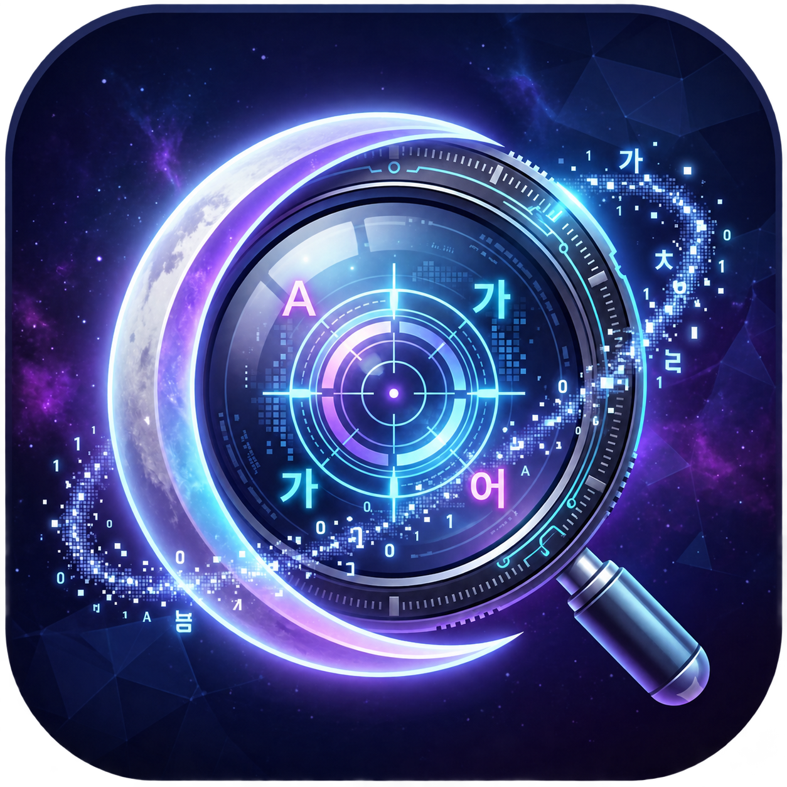

<p align="center">
  
</p>

<h1 align="center">DalvitLens (달빛렌즈)</h1>

<p align="center">
  <b>플레이의 흐름을, 한글로</b><br/>
  내 PC GPU 로컬 AI 번역 · 자동 학습 RPG 용어집 · 클릭 통과(Click-Through) 오버레이 · OBS 방송 송출
</p>

---

## 3분 사용 가이드 영상

<p align="center">
  <a href="https://youtu.be/rGeLjq0yW8I">
    
  </a>
</p>

- **가이드 영상 바로가기**: [https://youtu.be/rGeLjq0yW8I](https://youtu.be/rGeLjq0yW8I)
- 핵심 단축키(`F8` 주변 / `F9` 전체 / `F7` 다음 묶음 / `F10` 숨김), 번역 엔진 선택, 1초 단어 교정·자동 용어집, OBS 방송 투명 송출 세팅까지 3분 만에 확인할 수 있습니다.

---

## 주요 특징

- **원문 회피 & 클릭 통과 오버레이**: 인식된 영어 원문 영역을 피해 가장 가까운 빈 공간에 번역 카드를 자동 배치하고 번호표(`1, 2, 3`)로 대조합니다. 번역이 떠 있어도 마우스 클릭이 게임으로 그대로 통과하며 창 포커스를 빼앗지 않습니다.
- **게임 발번역 & OCR 노이즈 해결**: 스탯 아이콘 오인식 노이즈(`(A)`, 깨진 기호 등)를 자동 정제하고, RPG 전용 문맥 프롬프트와 조건문 수치(`below`=미만 / `above`=초과) 규칙으로 직역·오역을 잡아냅니다.
- **5종 번역 엔진 & 단일 GPU 메모리 관리**:
  - `EXAONE 3.5 7.8B` *(기본 추천 · 한국어 특화 고품질 로컬 GPU)*
  - `TranslateGemma 4B` *(중간 체급 로컬 GPU)*
  - `Hy-MT2 1.8B` *(초경량·초고속 로컬 GPU, 전용 VRAM ~1.5GB)*
  - `Google 간편 연결` *(API 키 불필요 · GPU 부하 0%)*
  - `Google Cloud` *(공식 Translation Basic API)*
  - 엔진 전환 시 이전 GPU 프로세스를 즉시 종료해 그래픽카드 메모리에 항상 단일 모델만 유지하며, 번역 캐시도 모델별로 독립 분리됩니다.
- **자동 학습 용어집 (`glossary.json`)**:
  - **무조작 백그라운드 수집**: 번역 오버레이를 먼저 화면에 띄운 뒤(체감 지연 0ms), 유휴 시간에 신규 대문자 UI 라벨·고유 스킬명을 자동 추출해 저장합니다.
  - **1초 단어 교정**: 설정 창 하단 교정 칸에서 어색한 단어만 고치고 `[교정 적용 · 용어집 학습]`을 누르면 한국어 조사(`을/를/이/가` 등)를 자동 분리해 핵심 명사 규칙을 영구 학습하고 현재 화면과 OBS에 즉시 반영합니다.
- **OBS Studio 1080p 투명 송출**: `http://127.0.0.1:18765/` 브라우저 소스 하나로 4K(`3840×2160`) 게임 좌표도 `1920×1080` 방송 캔버스에 자동 스케일링하며, 내 모니터와 OBS 송출 화면의 배경 불투명도를 개별 제어합니다.

---

## 빠른 시작 (설치 및 실행)

### 요구 환경
- **OS**: Windows 10 / 11 (64-bit), Windows 언어 설정 내 **영어(English · 미국) 기본 입력/OCR 언어 기능** 설치
- **GPU (로컬 AI 사용 시)**: NVIDIA GPU (CUDA 12.4 호환 드라이버)
  - *참고: 로컬 GPU 모델을 설치하지 않아도 `Google 간편 연결` 모드로 즉시 사용할 수 있으며, 설치 후 프로그램 안에서도 언제든 로컬 모델을 추가 설치할 수 있습니다.*

---

### 방법 A · 설치 마법사로 한 번에 설치 (일반 사용자 추천)

`git`이나 터미널 명령어 없이 단일 실행 파일 하나로 본체 설치부터 AI 모델 다운로드까지 완료됩니다.

1. GitHub 저장소의 **[Releases](https://github.com/geumryonglab/DalvitLens/releases)** 페이지에서 최신 **`DalvitLens-Setup.exe`** 파일 하나만 내려받아 실행합니다.
2. **환경 자동 점검 & 설치 경로 지정**: 마법사가 내 그래픽카드(VRAM)와 Windows 영어 OCR 설치 여부를 자동 확인합니다.
3. **AI 번역 모델 선택 다운로드**: 원하는 로컬 모델을 체크하면 필수 CUDA 구동 엔진(`llama-server`)과 모델 파일을 공식 서버에서 내려받고 `SHA-256` 무결성을 자동 검증합니다. *(건너뛰기 선택 시 본체만 1초 만에 설치되고 `Google 간편 연결`로 즉시 시작됩니다.)*
4. 바탕화면의 **`DalvitLens`** 아이콘을 실행하고 게임 속에서 **`F8`**(주변 번역) 또는 **`F9`**(전체 번역)을 누릅니다.
   - 설치 후 다른 모델을 추가하고 싶을 때는 프로그램 설정 화면의 **`[AI 모델 설치 · 관리]`** 버튼을 누르세요.

#### 로컬 AI 모델별 용량 및 권장 사양

| 모델명 | 다운로드 용량 | 권장 GPU VRAM | 특징 |
| :--- | :--- | :--- | :--- |
| **`EXAONE 3.5 7.8B`** *(기본 추천)* | 약 `4.5 GB` | `6 GB` 이상 | 한국어 표현력과 RPG 조건문·수치 이해도가 가장 뛰어난 주력 모델 |
| **`TranslateGemma 4B`** | 약 `2.3 GB` | `4 GB` 이상 | Google Gemma 기반 다국어 번역 특화 중간 체급 모델 |
| **`Hy-MT2 1.8B`** | 약 `1.1 GB` | `2 GB` 이상 | 전용 VRAM ~1.5GB만 사용하여 고사양 3D 게임 병행에 유리한 초경량 모델 |
| *공통 CUDA 12.4 구동 엔진* | 약 `640 MB` | NVIDIA GPU | 로컬 모델 최초 1회 설치 시 자동 포함 (`ggml-org/llama.cpp`) |

---

### 방법 B · 소스 코드 클론 및 직접 빌드 (개발자 / 포터블)

#### 1. 저장소 클론 및 빌드
별도 외부 SDK 없이 Windows 기본 내장 `.NET Framework 4.x` C# 컴파일러(`csc.exe`)만으로 본체(`DalvitLens.exe`)와 설치 마법사(`dist\DalvitLens-Setup.exe`)가 모두 빌드됩니다.

```powershell
git clone https://github.com/geumryonglab/DalvitLens.git
cd DalvitLens
powershell.exe -NoProfile -ExecutionPolicy Bypass -File .\build.ps1
```

#### 2. 로컬 GPU 런타임 및 AI 모델 CLI 설치 (선택)
프로그램 실행 후 **`[AI 모델 설치 · 관리]`** 창에서 클릭으로 설치하거나, PowerShell에서 원하는 모델 스크립트 하나만 실행하면 필수 CUDA 런타임(`Install-Runtime.ps1`)까지 자동으로 함께 설치·검증됩니다.

```powershell
# 기본 추천: 한국어 고품질 모델 EXAONE 3.5 7.8B 설치 (CUDA 런타임 자동 포함)
powershell.exe -NoProfile -ExecutionPolicy Bypass -File .\Install-Exaone.ps1

# (선택) 초경량 Hy-MT2 1.8B 설치
powershell.exe -NoProfile -ExecutionPolicy Bypass -File .\Install-HyMT.ps1

# (선택) TranslateGemma 4B 설치
powershell.exe -NoProfile -ExecutionPolicy Bypass -File .\Install-TranslateGemma.ps1
```

#### 3. 실행
`DalvitLens.exe`를 실행한 뒤 상태 표시줄에 **`GPU 준비 완료`**(또는 Google 모드 준비 완료)가 표시되면 게임을 테두리 없는 창모드로 띄우고 단축키를 사용합니다.

---

## 인게임 단축키

| 단축키 | 동작 설명 |
| :--- | :--- |
| **`F8`** (`Shift + F8` 지원) | 마우스 커서 주변(또는 고정 영역)의 스킬·아이템 툴팁을 빠르게 캡처하여 번역 |
| **`F9`** | 마우스가 위치한 모니터의 현재 활성 게임 창 전체 번역 |
| **`F7`** | 빈 공간이 부족해 나뉜 다음 문단 묶음(페이지) 넘겨 보기 |
| **`F10`** | 번역 오버레이 즉시 숨김 / 진행 중인 번역 취소 *(마우스 160px 이동·창 전환 시에도 자동 숨김)* |
| **`Ctrl + Alt + F8`** | 화면 위에서 직접 드래그하여 `F8` 캡처 영역 크기·위치 지정 (`선택한 위치에 고정` 지원) |

---

## OBS Studio 방송 연동

1. `DalvitLens.exe` 실행 중 OBS Studio의 장면(게임 캡처 소스 위)에 **브라우저(Browser)** 소스를 추가합니다.
2. 아래 속성을 입력합니다.
   - **URL**: `http://127.0.0.1:18765/`
   - **너비(Width)**: `1920` / **높이(Height)**: `1080`
3. OBS WebSocket 서버를 사용 중이라면 아래 스크립트로 `'게임화면'` 장면에 소스를 자동 추가할 수도 있습니다.
   ```powershell
   powershell.exe -NoProfile -ExecutionPolicy Bypass -File .\Connect-OBS.ps1
   ```

---

## 소스 빌드 및 릴리스 패키징

별도 외부 SDK나 인스톨러 도구 없이 Windows 기본 `.NET Framework 4.x` C# 컴파일러(`csc.exe`)만으로 즉시 빌드됩니다. 실행 시 본체 실행 파일(`DalvitLens.exe`)과 배포용 단일 설치 마법사(`dist\DalvitLens-Setup.exe`)가 함께 생성됩니다.

```powershell
powershell.exe -NoProfile -ExecutionPolicy Bypass -File .\build.ps1
```

---

## 라이선스 및 외부 모델 고지 (License & Third-Party Notices)

- **DalvitLens 소스 코드**: [MIT License](./LICENSE) (`Copyright (c) 2026 geumryonglab`)
- **외부 런타임 및 로컬 AI 모델 약관 안내**:  
  이 저장소는 AI 모델 가중치(`.gguf`) 및 외부 실행 바이너리를 직접 포함·재배포하지 않으며, 사용자가 설치 스크립트(`Install-*.ps1`)를 통해 각 공식 배포처에서 직접 내려받습니다. 내려받은 각 구성 요소는 원저작자의 라이선스 및 이용 약관을 따릅니다.
  - **llama.cpp Runtime** (`ggml-org/llama.cpp`): MIT License
  - **EXAONE 3.5 7.8B** (`LGAI-EXAONE/EXAONE-3.5-7.8B-Instruct-GGUF`): EXAONE AI Model License Agreement 1.1 - NC *(비상업적 용도 허용)*
  - **TranslateGemma 4B** (`google/translategemma-4b-it`): [Gemma Terms of Use](https://ai.google.dev/gemma/terms)
  - **Hy-MT2 1.8B** (`tencent/Hy-MT2-1.8B-GGUF`): Tencent Hunyuan / Official Repository License
